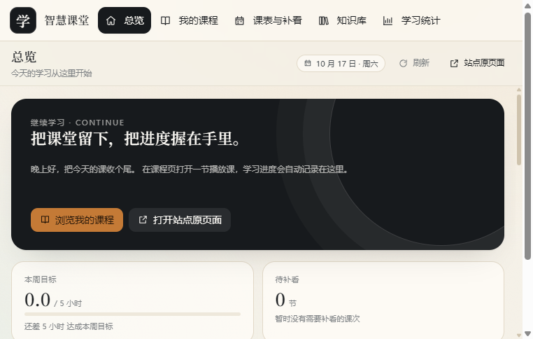
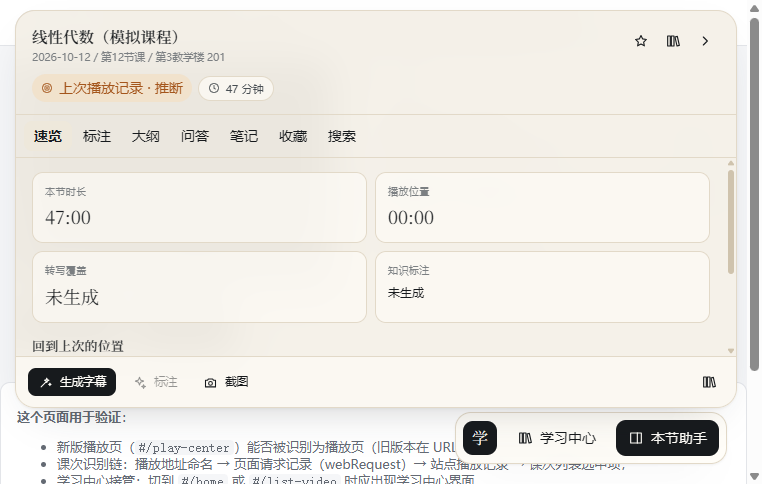

# HDUOnline - 杭电智慧课堂学习助手

将杭电智慧课堂（`course.hdu.edu.cn` / webVPN 代理）改造成**个人学习中心**的 Chromium MV3 扩展。

- **站点级学习中心**：首页、点播/直播列表页被总览、我的课程、课表与补看、知识库、学习统计接管，可一键切回站点原页面。
- **播放页本节助手**：本地转写、AI 知识标注与大纲、时间点问答、板书截图、时间戳笔记、收藏。
- **B 站学习助手**：B 站视频页的速览指标、字幕搜索、收藏此时刻、AI 时间点问答、AI 标注/独立大纲与时间轴标记、时间点笔记、q/b/n/[/] 快捷键，全程跟随分 P。
- **数据只在本机**：音频与模型推理不出设备；不调用站点写接口；不读取或转发 Cookie / Token。

| 学习中心（本地 fixture） | 播放页本节助手 |
|---|---|
|  |  |

> 截图为本地模拟站点与占位数据，仅用于展示界面结构。

## 目录

- [隐私与合规](#隐私与合规)
- [快速开始](#快速开始)
- [线上学习中心](#线上学习中心)
- [播放页本节助手](#播放页本节助手)
- [B 站学习助手](#b-站学习助手)
- [本地转写](#本地转写)
- [模型手动导入（国内推荐）](#模型手动导入国内推荐)
- [AI 服务配置](#ai-服务配置)
- [学习统计口径](#学习统计口径)
- [项目结构](#项目结构)
- [本地联调与测试](#本地联调与测试)
- [常见问题](#常见问题)
- [开发约定](#开发约定)
- [实现状态与验收边界](#实现状态与验收边界)
- [许可与免责](#许可与免责)

## 隐私与合规

- **音频不离开本机**：转写完全在浏览器内完成（WebGPU / WASM），不调用任何云端 ASR；原始音频与中间 PCM 不落盘。
- **只调用站点读接口**：不调用 `addVodWatchRecord` / `recordPlayInfo` / `addPlayTimes` / `keepAlive` /
  `vod/collection`(写) / `course/note`(写) 等写接口，不污染站点数据。
- **不接触凭据**：复用页面会话（`credentials: 'include'`），不读取、不存储、不转发 Cookie 与 Token。
- **零硬编码密钥**：源码、示例、测试中不含真实账号或 API Key；示例 Key 一律形如 `sk-test-not-a-real-key`。
- **AI 内容标识**：所有 AI 生成内容在 UI 上带「AI 生成」标识；AI 不可用时功能置灰，不阻塞视频播放。
- **数据可携带**：转写、收藏、笔记、统计全部存于本机 IndexedDB / OPFS，可导出、导入、分类清除。

## 快速开始

```bash
npm install          # postinstall 生成 WXT 类型，并复制 onnxruntime wasm 资源与图标
npm run dev          # 开发模式（自动加载扩展；开发构建会额外匹配本地 fixture）
npm run build        # 生产构建 → .output/chrome-mv3
npm run compile      # TypeScript strict 类型检查
npm test             # 单元测试（vitest）
npm run verify       # compile + test + build
```

### 加载到浏览器

1. `npm run build`
2. 打开 `chrome://extensions`，开启右上角「开发者模式」
3. 「加载已解压的扩展程序」→ 选择 `.output/chrome-mv3`

首次使用建议顺序：

**设置 → 转写与模型 → 准备模型** →（可选）**设置 → AI 服务** → 打开一节播放课 →
面板「生成字幕」→「生成知识标注」→ 在问答/笔记/收藏中沉淀。

## 线上学习中心

扩展不是只在播放页出现的侧载浮窗。进入站点后：

| 站点位置 | 扩展行为 |
|---|---|
| `#/home`、`#/list-video`、`#/list-live` | 学习中心接管层：总览 / 我的课程 / 课表与补看 / 知识库 / 学习统计；右上角「站点原页面」一键切回 |
| 任意页面 | 右下角常驻「学习中心」入口坞；播放页额外有「本节助手」开关 |
| 播放页（`#/play-center`、`#/video-detail`、`#/play-video`） | 本站播放器仍是主角；右侧本节助手面板 + 顶部课次胶囊（显示识别状态与课程） |
| 个人中心子页（课表 / 记录 / 收藏 / 笔记） | 保持站点原样，只提供入口坞；打开「我的课表」时会自动同步本周课表 |

学习中心的数据来自本机 IndexedDB：课程与课次在进入列表页时从站点只读同步（成功同步后 15 分钟内不重复），
之后与本地统计、转写、收藏合并展示。「我的课程」页提供「立即同步」按钮，可随时强制重新拉取；
同步失败会提示具体原因，不会把失败的一次请求计入 15 分钟节流。所有数据都可以在设置中分类清除。

## 播放页本节助手

入口会优先注入播放器控制条附近（「学习助手」菜单：本节助手 / 学习中心 / 收藏此时刻 / AI 标注）；
注入未命中时自动回退为右下角浮层入口，功能一致。

- **速览**：本节时长、播放位置、转写覆盖、知识标注状态；站点断点 / 上次提问 / 笔记多锚点回跳。
- **标注**：AI 提取 3–30 个知识点（名称、摘要、时间区间、置信度），点击跳转；低置信度可隐藏。
- **大纲**：两级结构，点击跳转；播放中当前节点高亮，可跟随滚动。
- **问答**：以当前播放位置为锚点，只依据附近字幕回答；回答标注依据时间，可回跳、可收藏；
  字幕不足时明确提示，支持扩大窗口重答。
- **笔记**：自动带当前时间；可转收藏、可删除；站点原生笔记只读展示，不写入站点。
- **收藏**：时间点 / AI 回答 / 大纲节点 / 截图，统一进入知识库；站点收藏状态只读显示，不双写。
- **搜索**：本地检索本节字幕，结果带时间点；空结果提示随关键词长度变化，超长词会点名引导取核心词重搜。
- **截图**：取当前机位当前帧，按设置加水印，存入本机知识库（可作为收藏对象）。
- **字幕**：独立 Shadow DOM 字幕层，字号/颜色/位置可调，不写入站点 `.player-caption`。
- **窗口档位**：问答与标注工具行可选「窗口 小/中/大」，只对当次生成生效。

## B 站学习助手

B 站视频页右下角有一枚「学习」主入口，点开向上展开「收藏 / 字幕 / 学习助手 / 学习中心」
四个功能子入口（第 44 轮起由四枚独立悬浮入口收敛而来）；助手面板含
「速览 / 问答 / AI 标注 / 大纲 / 笔记」五个页签，行为跟随当前分 P（`?p=`）。

- **速览**：视频时长 / 播放位置 / 字幕覆盖 / 知识标注四格，附「回到上次的位置」快捷跳转。
- **字幕搜索**：按关键词过滤官方字幕，点击结果跳到对应时间点；空结果提示随关键词长度变化，超长词会点名引导取核心词重搜。
- **收藏此时刻**：把当前播放时间点存入知识库；不依赖字幕。
- **问答**：以当前播放位置为锚点，流式回答、可停止；无官方字幕时友好提示、不发起请求；
  AI 回答可一键收藏进知识库。
- **AI 标注与大纲**：知识点卡片与两级大纲（独立页签、当前节点高亮），点击跳转；
  播放器时间轴上方叠加知识点标记条。
- **笔记**：带时间戳的笔记，点击时间戳回跳；可一键转收藏；不依赖字幕。
- **快捷键**：`q` 问答 / `n` 笔记 / `b` 收藏此时刻 / `[` `]` 大纲节点间跳转；输入态与
  B 站播放器原生按键自动让行，配置与杭电侧同源。
- **窗口档位**：问答/标注可选「窗口 小/中/大」，只对当次生成生效。
- **学习中心**：第 4 枚入口打开「知识库 / 今日 / 统计」三页签面板——知识库集中管理
  B 站收藏（搜索 + 五类类型筛选、加入复习、编辑、从收藏夹批量导入、导出复习卡片、
  查看已就绪字幕）；今日页签展示今日到期复习并可勾选完成；统计页签含 B 站观看统计卡
  与学习周报/月报。
- **复习联动**：B 站收藏进入复习计划后，「去复习」直接跳回视频对应时间点。
- **学习统计**：观看时长进入本机统计，可在统计页/看板查看 TopN、最近观看与连续天数。

## 本地转写

流程：`新鲜直链 → MP4 音轨定位（只拉音频字节，通常为整文件 1–3%）→ WebCodecs 解码 AAC
→ 重采样 16kHz 单声道 → Whisper 分段推理（带时间戳）→ 术语纠错 → 增量落库`。

- **模型档位**：快速（base，约 150MB）/ 标准（small，约 480MB，默认）/ 高精度（large-v3-turbo，约 1.6GB）。
- **设备选择**：WebGPU 可用则 `webgpu + fp16`，否则 `wasm + q8`；未跨源隔离时强制单线程。
- **片段流式为默认**：只转当前播放位置前后 N 分钟（2–30，默认 10），播放推进时自动滚动补齐；
  已转分片（10 分钟粒度）落库复用，不重复转写。长视频不会一次性拉完整段音频。
  - 打开播放页后按节拍静默评估；不弹提示、不打断播放；失败指数退避，连续失败静默停手。
  - 用户取消后自动跟进会抑制一段时间；拖动进度、手动转写或重新打开页面即恢复。
  - 面板「重新生成」在片段模式下只重转当前片段，不影响其他分片。
  - 需要整段覆盖时，可在设置中把转写范围切回「整段」。
- **断点续跑**：作业以 10 分钟为粒度，已完成分片写入 IndexedDB；中断后点「继续」即可续跑。
- **降级**：主路径失败 → 整文件下载 + `decodeAudioData`（400MB 护栏）→ 被护栏拦下时提示改用片段模式。
- **隐私**：原始音频与中间 PCM 不落盘；仅保存转写文本与分段。

## 模型手动导入（国内推荐）

1. 打开「设置 → 转写与模型」，确认当前档位（默认「标准」→ `onnx-community/whisper-small`）。
2. 从镜像站下载该模型的完整目录：

   | 档位 | 下载页 | 必需文件 |
   |---|---|---|
   | 快速 | `https://hf-mirror.com/onnx-community/whisper-base/tree/main` | `onnx/encoder_model*.onnx`、`onnx/decoder_model_merged*.onnx`、`tokenizer.json`、`config.json`、`generation_config.json` |
   | 标准 | `https://hf-mirror.com/onnx-community/whisper-small/tree/main` | 同上（`*_fp16.onnx` / `*_q8.onnx` 任一套） |
   | 高精度 | `https://hf-mirror.com/onnx-community/whisper-large-v3-turbo/tree/main` | 同上（建议 q4 量化） |

3. 设置页点「选择模型目录」，选中**模型目录**（保留 `onnx/` 子目录结构）→ 文件写入本机 OPFS。
4. 状态显示「已就绪」后，即可在播放页生成字幕；整个过程无需联网。

内置下载默认使用 `https://hf-mirror.com`，支持断点续传。自定义模型源会触发 host 权限申请；
WASM 运行时资源固定指向扩展内置 `wasm/`，不依赖外部 CDN。

## AI 服务配置

「设置 → AI 服务」支持三种请求格式：

| 格式 | 端点 | 预设示例 |
|---|---|---|
| `anthropic-messages` | `POST {base}/v1/messages` | Anthropic Claude（自动携带浏览器直连所需头） |
| `openai-chat` | `POST {base}/v1/chat/completions` | OpenAI、DeepSeek、Kimi、硅基流动、Ollama 等 |
| `openai-responses` | `POST {base}/v1/responses` | OpenAI Responses API |

- API Key 只存 `chrome.storage.local`，**绝不进 `storage.sync`**，不参与账号云同步；日志自动打码。
- 自定义端点保存时，在用户手势下通过 `optional_host_permissions` 申请 host 权限；拒绝则保存失败。
- 本地端点（如 `http://127.0.0.1:11434`）默认拒绝；需显式开启「允许本地推理端点」。
  云元数据地址始终拒绝（防 SSRF）。
- 请求由 Service Worker / Offscreen 发出；SSE 流式渲染，支持停止生成、超时与有限重试。
- 设置页支持分区直达：`options.html#learning` 等分区 hash（ai / asr / learning / data / about），刷新后保持原分区。

## 学习统计口径

- 只累计「视频播放中 + 页面处于前台可见 + 未触发挂机」的墙钟时间，**与倍速无关**。
- 挂机阈值默认 15 分钟（可配）；单日封顶 16 小时；重复观看重复计入。
- 跨零点按本地自然日拆分；`valid=false` 的异常流水保留用于审计，但不进报表。
- 完看度 = 有效观看 / 课次时长（上限 100%）；达到阈值（默认 90%）标记为已看完。
- 补看清单：课次结束超过 N 小时（默认 24h）仍无有效观看时列入，可标记「已到课」排除。
  **仅供个人参考，非考勤依据。**
- 所有数字来自本机，不上报站点，也不读取站点看板。
- 学习统计页附「学习成就」徽章区：连续 / 时长 / 收藏 / 复习 / 笔记等 9 类预置里程碑，
  支持自定义徽章与目标倍率，含解锁时间线；附「标签统计」看板（按标签聚合收藏 / 复习中 /
  已完成 / 完成率，近 4/8/12 周完成趋势，点柱查看该周明细并导出 CSV）。
- 标签长期零完成（有完成记录但近 4 周零完成）会在周报通知与统计面板中提醒。

## 项目结构

```
src/
├─ entrypoints/
│  ├─ content/        # 内容脚本：路由识别 / 课次解析 / 站点只读 API / 播放器 / Shadow DOM UI
│  │  ├─ site/        # api / routes / player / sessionResolve / observations / navigation
│  │  └─ ui/          # 学习中心 / 本节助手 / 时间轴 / 字幕 / 组件 / 样式；learning/ 视图与共享件（含错误边界）
│  ├─ background/     # SW 编排器：消息路由、统计、转写、AI、定时任务、站点请求只读观测
│  ├─ offscreen/      # 长任务宿主：ASR Worker、兜底解码、LLM 流式、截图
│  ├─ asr-worker.ts   # 音轨提取 → WebCodecs 解码 → 重采样 → Whisper
│  └─ popup/ options/ dashboard/
├─ core/
│  ├─ db/             # IndexedDB schema + 迁移 + 仓储 + 回收站
│  ├─ asr/            # MP4 解析 / 重采样 / Whisper / OPFS 模型缓存 / 词表 / 片段跟随
│  ├─ llm/            # 三适配器 + SSE + 提示词 + 严格 JSON 校验
│  ├─ stats/          # 统计引擎与报表聚合
│  ├─ plan/           # 目标体系 / 打卡 / 今日待办 / 复习规划 / 成就 / 引导（纯函数）
│  ├─ search/         # 统一搜索聚合器（四路归并 / 摘要 / 高亮解析）
│  ├─ export/         # Markdown / CSV / JSON + ZIP 备份与导入
│  └─ shared/         # 类型、消息协议、操作注册表、设置、URL 校验、日志
public/wasm/          # onnxruntime-web 资源（生成物；prebuild 自动复制）
public/icon/          # 扩展图标（生成物；脚本再生）
tests/                # vitest 单测 + 本地站点 fixture
docs/                 # 用户手册等
```

## 本地联调与测试

```bash
npx wxt build --mode development   # dev 构建会额外匹配 http://127.0.0.1/*
node tests/fixtures/serve.mjs      # 本地模拟站点：http://127.0.0.1:8788
npm run e2e                        # 自动起模拟服务 + 真实 Chrome + 扩展运行时断言
```

fixture 复刻站点关键结构（主/副画面 3 路 `<video>`、`.jy-control-progress`、课次列表、站点字幕/笔记占位），
并提供模拟只读接口、Range 与 CORS 头。若放入 `tests/fixtures/sample.mp4`（自备、不入库），
可验证转写全链路。

## 常见问题

**面板没有出现？**
确认页面是播放页（`#/play-center` / `#/video-detail` / `#/play-video`）。新版播放页若自动识别失败，
面板顶部会显示「待识别课次」，点右侧从课次列表手动选择即可。仍无面板时刷新页面并查看「设置 → 数据与隐私 → 日志」。

**转写很慢 / 提示模型未准备？**
先在设置页确认模型档位「已就绪」（推荐手动导入）。WASM 单线程约 0.2–0.6× 实时，
47 分钟课次可能需要 1.5–4 小时；建议「快速」档或支持 WebGPU 的设备。

**AI 功能置灰？**
「设置 → AI 服务」添加并启用 provider，然后用「测试」确认端点互通。转写、收藏、统计不依赖 AI。

**截图失败？**
截图有三条路径（Offscreen 原始帧 → 页面帧 → 仅记录时间点）。若直链未放行 CORS，
会退化为「仅记录时间点」，面板会提示。

**插件会修改站点收藏或笔记吗？**
不会。站点收藏/笔记只做只读展示，插件数据完全独立。

**数据会同步到云端吗？**
不会。所有数据在本机；导出由你手动触发。

## 开发约定

- TypeScript strict，`npm run compile` 零错误；`npm test` 全绿；`npm run verify` 通过后才能提交。
- 修改提示词必须升 `PROMPT_VERSION`（触发 AI 结果缓存失效）。
- 新增站点选择器请同步更新 `src/core/shared/constants.ts` 的 `SELECTORS`。
- 提交前不得包含真实凭据、真实视频直链或抓取到的课程内容。
- WXT 入口产物名按首个 `.` 截断（`entrypoints/asr-worker.ts` → `asr-worker.js`）；新增运行时引用后请核对产物名。

## 实现状态与验收边界

- 工程、核心数据层、站点对接、播放页助手、学习中心、B 站学习助手、Popup / Options / Dashboard 均已实现；
  `npm run verify`（类型检查 + 1883 项单测 + 生产构建）通过，`npm run e2e` 223 项运行时断言全绿。
- 1.1.0 能力概览（节选）：统一搜索多端对齐（关键词高亮 / 清除 / 计数 / 空态引导 / 最近搜索回放，覆盖学习中心顶栏 / B 站字幕浮层 / 学习中心知识库 / 看板知识库，见
  `docs/搜索体验三端对照.md`）；目标体系（每日 / 每周目标 + 设置页 / 总览 / 看板 / 统计页 / 月历五处同源预览）；
  渲染错误兜底三级体系（四入口 ErrorBoundary → 学习中心六视图与看板四视图视图级边界 → B 站助手三页签边界，
  降级卡片含「重试当前界面 / 刷新页面」双按钮并适配暗色）。
- **仍需真实账号 + 真实站点人工验收**：新播放页课次识别跟随、真实 47 分钟转写、截图跨源、
  双源（校内 / webVPN）注入、学习中心与站点原页面切换、统计口径。
- 已知取舍：
  - `webRequest` 仅用于只读观测两个课次接口；Chrome 的安装提示是通用的“读取浏览记录”。
  - `#/play-center` 深链是否接受 `courseId` 尚未实测；扩展会在 URL 与正在播放的媒体冲突时以媒体为准。
  - 未启用 COEP/COOP（会破坏跨源取流与模型下载），因此 WASM 默认单线程。
  - 扩展页面创建的 ASR Dedicated Worker 中 `chrome.*` 不可用；`wasmPaths` 由 Worker 自身
    `chrome-extension://` URL 推导为内置 `wasm/` 目录（已用真实 Chrome 验证本地 jsep 模块可加载、
    无 jsdelivr 请求），真实模型推理仍需人工复测。

## 许可与免责

**许可证**：暂未选定。发布前请确定许可证并补齐 `LICENSE` 文件，同时更新 `package.json` 的 `license` 字段。

**免责**：本项目为个人学习辅助工具：不下载、不分发视频与音频文件；不绕过任何访问控制；
补看清单等提示信息「仅供个人参考，非考勤依据」。使用前请遵守学校平台使用条款。
